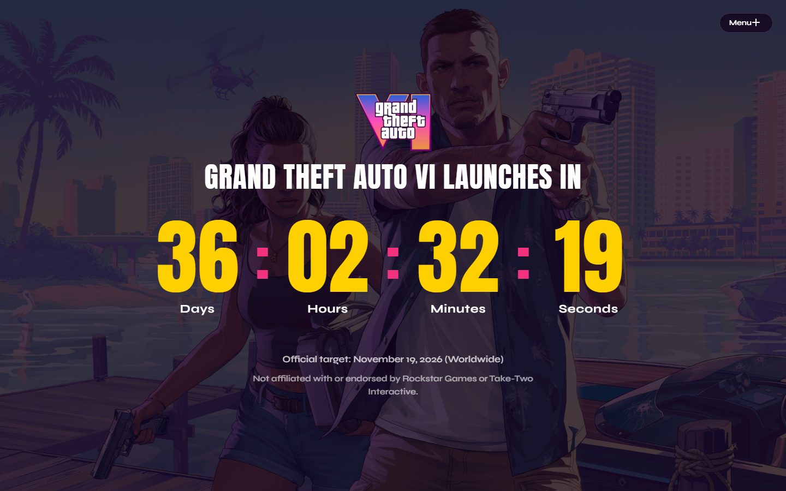

# GTA VI Countdown

> An authentic Vice City aesthetic countdown landing page for Grand Theft Auto VI.



## Overview

**GTA VI Countdown** is a single-section landing page that tracks the remaining time until the launch of Grand Theft Auto VI. Built with a vibrant Florida sunset and Vice City color palette (neon pinks, sunburst yellows, and deep purple dusk), the interface combines monumental typography, Vice City artwork, and interactive theme customization.

- **Live Demo**: [https://wesleymaik.github.io/gta-vi-countdown/](https://wesleymaik.github.io/gta-vi-countdown/)

---

## Features

- **Live Real-Time Countdown**: Calculates days, hours, minutes, and seconds remaining until the worldwide launch date.
- **Configurable Release Date**: Consumes release date information from `public/db.json` with dynamic fetching and instant fallback support.
- **Interactive Theme Switcher**: Slide-out menu powered by GSAP with custom thumbnail previews and matching color palettes.
- **5 Vice City Themes**:
  1. *Vice Sunset* (Jason & Lucia on the dock)
  2. *Vice Skyline* (Dusk over the city)
  3. *Neon Supercar* (Midnight Vice City strip)
  4. *Leonida Keys* (Tropical waters and highway)
  5. *Lucia Caminos* (Lucia in Vice City)
- **Cinematic Transitions**: Seamless hardware-accelerated crossfade between wallpapers and smooth color transitions across all typography and scrim overlays.
- **Auto-Rotation Mode**: Optional autoload switch in the theme menu that smoothly cycles themes every 30 seconds (enabled by default, persisted in `localStorage`).
- **Responsive Typography**: Built with Anton and Syne, scaling from ultra-wide displays down to mobile viewports (390px).
- **Automated Deployment**: GitHub Actions workflow (`.github/workflows/deploy.yml`) builds and publishes static files to GitHub Pages (`gh-pages`) upon push.

---

## Tech Stack

- **Framework**: [React 19](https://react.dev/) + [TypeScript](https://www.typescriptlang.org/)
- **Bundler**: [Vite 6](https://vitejs.dev/)
- **Styling**: [Tailwind CSS v4](https://tailwindcss.com/) with `@tailwindcss/vite`
- **Animations**: [GSAP 3](https://greensock.com/gsap/)
- **Deployment**: [GitHub Actions](https://github.com/features/actions) & [GitHub Pages](https://pages.github.com/)

---

## Getting Started

### Prerequisites

- [Node.js](https://nodejs.org/) (version 18 or higher recommended)
- [npm](https://www.npmjs.com/) or [pnpm](https://pnpm.io/)

### Installation

1. Clone the repository:
   ```bash
   git clone https://github.com/WesleyMaik/gta-vi-countdown.git
   cd gta-vi-countdown
   ```

2. Install dependencies:
   ```bash
   npm install
   ```

3. Start the local development server:
   ```bash
   npm run dev
   ```

4. Build for production:
   ```bash
   npm run build
   ```

5. Preview production build locally:
   ```bash
   npm run preview
   ```

---

## Configuration

The target release date is managed centrally in [`public/db.json`](public/db.json):

```json
{
  "releaseDate": "2026-11-19T00:00:00Z"
}
```

Updating this date will automatically update the countdown timer on the next page reload or build.

---

## Project Structure

```
gta-vi-countdown/
├── .github/
│   └── workflows/
│       └── deploy.yml          # GitHub Pages CI/CD workflow
├── docs/
│   └── screenshot.jpg          # Repository preview screenshot
├── public/
│   ├── assets/                 # GTA VI wallpapers & logo
│   ├── db.json                 # Release date configuration
│   └── favicon.svg             # Custom Vice City favicon
├── src/
│   ├── components/
│   │   ├── CountdownDisplay.tsx # Grid of countdown units
│   │   ├── CountdownUnit.tsx    # Single unit component
│   │   ├── StaggeredMenu.tsx    # GSAP slide-out drawer
│   │   └── ThemeSelector.tsx    # Theme thumbnails & swatches
│   ├── hooks/
│   │   └── useCountdown.ts      # Real-time countdown calculation hook
│   ├── types/
│   │   └── theme.ts             # Theme palettes and interface definitions
│   ├── App.css                  # Animations, transitions, responsive layout
│   ├── App.tsx                  # Main application container
│   ├── index.css                # Tailwind CSS v4 directives
│   └── main.tsx                 # React application entry point
├── package.json
├── tsconfig.json
└── vite.config.ts
```

---

## Disclaimer

This is a non-commercial, fan-made project created for countdown and entertainment purposes only. Not affiliated with, authorized by, endorsed by, or in any way officially connected with **Rockstar Games**, **Take-Two Interactive Software**, or any of their subsidiaries or affiliates. Grand Theft Auto and related trademarks are the property of their respective owners.
